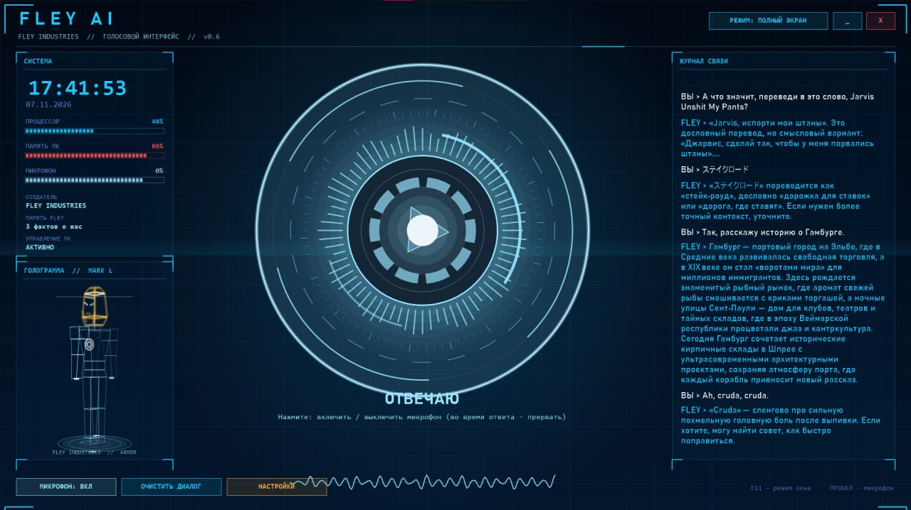
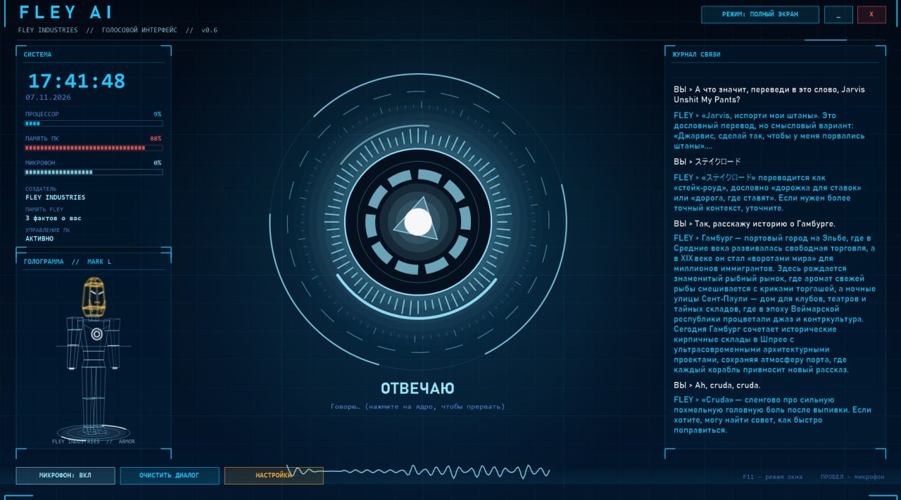

FLEY AI-Voce - a voice AI assistant that will not only talk with you but can also control your PC: open links, websites, 
and programs, create files, presentations, write code, and even shut down and turn on your PC, work with a printer, and do just about anything.

**FLEY AI-Voce** — голосовой AI-ассистент, который не только будет с вами разговаривать, но и сможет управлять вашим ПК: открывать ссылки, сайты и программы, создавать файлы, презентации, писать код и даже выключать и включать ПК, работать с принтером и делать практически что угодно.





[https://github.com/AnonimusShamshiAlex/FLEYAI/blob/main/FLEY_AI_Setup.exe](https://github.com/AnonimusShamshiAlex/FLEYAI/blob/main/FLEY_AI_Setup.exe) Download

Download https://drive.google.com/file/d/19O_UKn-xjBEumWeXcayYNwwAy2dfpmSh/view?usp=sharing FleyAISetup

Download https://drive.google.com/file/d/12uNn00gpSSgWfs_6ZK1oeR9RyAvFX4Nl/view?usp=sharing FleyAI0.6v

Download https://drive.google.com/file/d/1CBeSwrD9NzC3PQzgdXqqaZ0bFbTedY8U/view?usp=sharing 👈

Я не могу дать свой API, потому что сервис меня заблокирует за превышение лимитов. Но ты можешь прямо сейчас за 1 минуту получить свой собственный бесплатный ключ вот здесь: https://console.groq.com/keys
и вставить в .env GROQ_API_KEY=<Таое API>

I can't give you mine API because the service will block me for exceeding the limits. But you can get your own free key right now in just 1 minute here: https://console.groq.com/keys

in .env GROQ_API_KEY=<YOU_API>

https://console.groq.com/keys API If you want your own API, they'll bring it to you — and I simply recommend Groq.

Если вы хотите собственный API, вам его предоставят — а я просто рекомендую Groq.

I've prepared a full API for you in env — a voice AI assistant that will not only talk with you but can also control your PC: open links, websites, 
and programs, create files, presentations, write code, and even shut down and turn on your PC, work with a printer, and do just about anything.

Я подготовил для вас полный API в env свой API — голосовой AI-ассистент, который не только будет с вами разговаривать, 
но и сможет управлять вашим ПК: открывать ссылки, сайты и программы, создавать файлы, презентации, писать код и даже выключать и включать ПК, 
работать с принтером и делать практически что угодно.


# FLEY AI 0.5 — C++ версия (Windows), Groq

Нативная программа на C++17: Win32 + GDI+ (окно), waveIn (микрофон), WinHTTP (сеть), PlaySound (звук).
Без Python и без внешних библиотек. Итог — один `FLEY AI.exe` (~1–2 МБ).

## Сборка одним кликом
Дважды щёлкните **build.bat**. Он сам найдёт компилятор (g++ или Visual C++). Если компилятора нет,
поставит MinGW-w64 через winget (один раз) и соберёт. Результат: `dist\FLEY AI.exe` + `dist\.env`.

## Использование
- Клик по кругу (или Пробел): слушать → через ~2 с тишины после речи ответ голосом (настраивается FLEY_SILENCE_SECONDS).
- Клик во время записи: закончить сразу. Клик во время озвучки: прервать.
- Внизу окна: «Вы слышали: …» и «FLEY: …». Кнопка «Настройки (.env)» открывает файл с ключом.
- Ключ в `.env` рядом с exe, правки подхватываются без перезапуска. Поддерживаются:
  **Groq (`gsk_...`, бесплатно)**, OpenRouter (`sk-or-...`), OpenAI (`sk-...`).
- Режим Groq: речь → whisper-large-v3, ответ → openai/gpt-oss-120b, озвучка → встроенный мужской голос Windows
  (русский берётся из Параметры → Время и язык → Речь; если его нет, программа скажет об этом).

## Структура
- `src/core.hpp` — переносимое ядро: JSON, .env, WAV, multipart, определение конца речи (VAD), тексты ошибок.
- `src/main.cpp` — Windows-часть: окно, микрофон, HTTP, звук.
- `tests/test_core.cpp` — тесты ядра (`run_tests.bat`).

Ошибки пишутся в `fley.log` рядом с exe. Файл `.env` содержит ваш ключ — не отправляйте его другим.

## Управление компьютером голосом (0.4)
Скажите, например: «открой Telegram», «включи на ютубе Imagine Dragons», «найди на ютубе обзор GTX 1650»,
«найди файл договор», «прочитай файл notes.txt на рабочем столе», «сколько свободно места на диске»,
«сделай громче», «следующий трек», «заблокируй компьютер», «открой папку загрузки».
- Сразу, без вопросов: открыть программу/сайт/YouTube/файл/папку, поиск файлов, чтение текстовых файлов, состояние ПК, громкость, медиа, блокировка.
- Только после «Да» в окне подтверждения: выполнить команду Windows (`run`), удалить (в Корзину), закрыть программу, выключить/перезагрузить/сон.
  Выключение идёт с задержкой 30 с и отменяется фразой «отмени выключение». Системные папки удалять нельзя.
- Что сделала программа, видно в диалоге строками «Действие: …» и в `fley.log`.
- Отключить управление ПК: `FLEY_PC_CONTROL=0` в `.env`.
- Существующий `dist\.env` при пересборке не перезаписывается.

## Голос и скорость (настройки в .env)
- `FLEY_REASONING=low` — модель почти не «думает» перед ответом (medium/high — медленнее, но глубже).
- `FLEY_SILENCE_SECONDS=1.8` — сколько тишины ждать после вашей речи.
- `FLEY_VOICE_PITCH=0.85` (ниже = глубже), `FLEY_VOICE_RATE=1.0` — высота и скорость голоса Windows.
- `FLEY_WINDOWS_VOICE=Pavel` — выбрать конкретный установленный голос (часть имени). Для английского, например, `George` или `Ryan`.
- `FLEY_CALL_ME=сэр` — как к вам обращаться.

## Версия 0.5: HUD, постоянный диалог, память
- Окно на весь экран в стиле HUD Тони Старка (ядро-реактор, кольца, эквалайзер, панель системы, журнал). Esc - выход, Пробел или клик по ядру - микрофон вкл/выкл.
- Микрофон слушает постоянно, как телефонный звонок: сказали фразу - ответ - снова слушает. Пауз и нажатий нет. Порог шума адаптивный, конец фразы через `FLEY_SILENCE_SECONDS` (0.9 с).
- Пока FLEY говорит, микрофон закрыт (чтобы не слышать самого себя). Прервать - клик по ядру или Пробел.
- Новый голос: мужской голос Windows + эффект «голос ИИ» (`FLEY_VOICE_FX=0` отключает). Первое предложение звучит сразу, остальное досинтезируется.
- Память: `fley_memory.txt` (факты о вас, FLEY сам их запоминает) и `fley_history.txt` (последние реплики) рядом с exe. Сохраняется между запусками. «Очистить диалог» память фактов не стирает; «забудь …» - стирает.
- Действия без разрешений (`FLEY_CONFIRM=0`). Новые: `web_search` (актуальная информация из интернета), `type` (печать), `key` (сочетания клавиш), `wait`, `remember`/`forget`.
- Защита: если в ходе разговора FLEY прочитал файл или страницу из интернета, опасные действия (run, delete, close_app, power) в этом ходе всё равно спросят подтверждение; системные папки удалять нельзя; удаление идёт в Корзину; выключение с задержкой 30 с.
- `FLEY_WAKE=флей` - отвечает только на обращение (после него 25 с можно говорить без слова); защита от телевизора и чужих голосов.
- `FLEY_AUTOSTART=1` - запуск вместе с Windows.


# 🤖 FLEY AI — Голосовой интерфейс ассистента

**FLEY AI** — это легковесный, футуристичный голосовой интерфейс на C++, разработанный для взаимодействия с большими языковыми моделями (LLM) и управления операционной системой персонального компьютера. 

Интерфейс выполнен в стиле продвинутого sci-fi терминала с динамической индикацией системных ресурсов и состояния микрофона.

---

## 🎯 Основные возможности

* **🎙️ Голосовой ввод:** Управление микрофоном в реальном времени (включение/выключение по клику на ядро или по клавише `Пробел`).
* **🧠 Интеграция с ИИ:** Поддержка локальных и облачных моделей (по умолчанию настроена интеграция с `openai/gpt-oss-120b`).
* **💻 Управление ПК (Действия):**
  * Открытие веб-браузера (команда `open_app: chrome`).
  * Поиск и воспроизведение видео (команда `youtube_play: мультфильм`).
  * Поиск и запуск локальных файлов по названию или пути.
* **📊 Мониторинг системы:** Отображение текущего времени, загрузки процессора (CPU) и оперативной памяти (RAM) в режиме реального времени.

---

## 🛠️ Стек технологий

* **Язык программирования:** C++ (Стандарт C++17 или выше)
* **Ядро/ИИ:** OpenAI-совместимый API протокол
* **Скрипты автоматизации:** Batch-скрипты для Windows (`.bat`)

---

## 📁 Структура проекта

```text
FLEY_AI_CPP/
├── src/
│   ├── core.hpp         # Основная логика приложения и системные вызовы
│   └── main.cpp         # Точка входа в приложение
├── tests/
│   └── test_core.cpp    # Модульные тесты для проверки логики
├── .env.example         # Пример конфигурационного файла для API-ключей
├── build.bat            # Скрипт автоматической сборки проекта
├── run_tests.bat        # Скрипт для запуска тестов
└── README.md            # Документация проекта
```

---

## 💻 Как запустить проект локально

### 1. Клонирование репозитория
```bash
git clone https://github.com/AnonimusShamshiAlex/FLEYAI
cd FLEYAI
```

### 2. Настройка переменных окружения
Переименуйте файл `.env.example` в `.env` и добавьте ваши настройки API (например, ключ OpenAI или адрес локального сервера):
```env
# Пример содержимого .env
API_KEY=your_secret_api_key_here
MODEL_NAME=openai/gpt-oss-120b
```

### 3. Сборка проекта
Для компиляции исходного кода на Windows запустите готовый скрипт сборки:
```bash
build.bat
```

### 4. Тестирование
Чтобы убедиться, что основные компоненты ядра работают стабильно, выполните:
```bash
run_tests.bat
```

---

## 🕹️ Использование

1. Запустите собранный исполняемый файл.
2. Для активации голосового ввода нажмите клавишу **Пробел** или кликните по центральному анимированному ядру.
3. Произнесите команду (например: *"Открой мультик"* или спросите *"Ай си захватит мир?"*).
4. Чтобы выйти из приложения, нажмите **ESC**.

---


## Про .env

Настройка файла .env нужна для того, чтобы приложение FLEY AI могло безопасно получать секретные ключи (например, от OpenAI или другого ИИ-провайдера) и знало, к какой языковой модели подключаться, не раскрывая ваши личные данные на GitHub.
В вашем проекте уже есть шаблон .env.example. Вот пошаговый процесс, как превратить его в рабочий конфиг.

Шаг 1. Создание реального файла .env

Файлы, начинающиеся с точки (например, .env), содержат ваши личные секреты. На GitHub их загружать нельзя.
1. Зайдите в корневую папку проекта FLEY_AI_CPP.
2. Скопируйте файл .env.example и переименуйте копию просто в .env (удалите расширение .example).
3. Если у вас Windows не позволяет создать файл без имени, просто откройте .env.example в текстовом редакторе (Блокнот, VS Code) и выберите "Сохранить как..." -> укажите имя .env и тип файла "Все файлы (.)".

Шаг 2. Заполнение параметров

Откройте созданный файл .env и впишите туда актуальные данные. Для вашего проекта (судя по скриншотам, где используется модель openai/gpt-oss-120b) базовая настройка выглядит следующим образом:
env
# URL-адрес сервера ИИ (оставьте пустым для стандартного OpenAI или укажите свой локальный/сторонний хост)
AI_API_BASE_URL=https://openai.com

https://console.groq.com/keys 👈

# Ваш личный секретный API-ключ (замените на ваш настоящий токен)
AI_API_KEY=sk-proj-XXXXXXXXXXXXXXXXXXXXXXXXXXXX

# Имя используемой языковой модели (как на экране приложения)
AI_MODEL_NAME=openai/gpt-oss-120b

# Дополнительные настройки интерфейса (если поддерживаются вашим core.hpp)
APP_PORT=3000
DEBUG_MODE=true
Используйте код с осторожностью.

Шаг 3. Защита ключей от попадания на GitHub (Очень важно!)

Чтобы случайно не слить свой приватный ключ в интернет, создайте в корне проекта файл с именем .gitignore (если его еще нет) и добавьте туда строчку, которая запретит Git отслеживать ваш рабочий .env:
text
# Скрываем секретные ключи приложения
.env

API https://console.groq.com/keys

Download https://drive.google.com/file/d/1CBeSwrD9NzC3PQzgdXqqaZ0bFbTedY8U/view?usp=sharing

