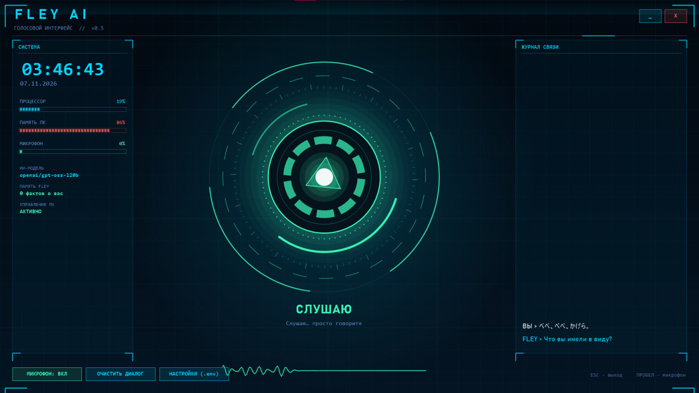
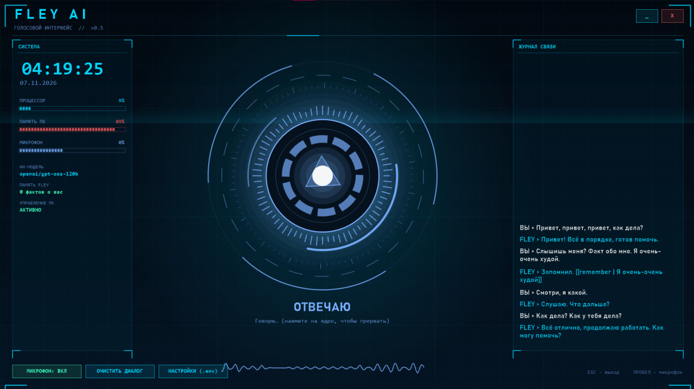

FLEY AI-Voce - a voice AI assistant that will not only talk with you but can also control your PC: open links, websites, 
and programs, create files, presentations, write code, and even shut down and turn on your PC, work with a printer, and do just about anything.

Download https://drive.google.com/file/d/1CBeSwrD9NzC3PQzgdXqqaZ0bFbTedY8U/view?usp=sharing

Я не могу дать свой, потому что сервис меня заблокирует за превышение лимитов. Но ты можешь прямо сейчас за 1 минуту получить свой собственный бесплатный ключ вот здесь: https://console.groq.com/keys

I can't give you mine because the service will block me for exceeding the limits. But you can get your own free key right now in just 1 minute here: https://console.groq.com/keys

https://console.groq.com/keys API If you want your own API, they'll bring it to you — and I simply recommend Groq.

Если вы хотите собственный API, вам его предоставят — а я просто рекомендую Groq.

I've prepared a full API for you in env — a voice AI assistant that will not only talk with you but can also control your PC: open links, websites, 
and programs, create files, presentations, write code, and even shut down and turn on your PC, work with a printer, and do just about anything.

Я подготовил для вас полный API в env свой API — голосовой AI-ассистент, который не только будет с вами разговаривать, 
но и сможет управлять вашим ПК: открывать ссылки, сайты и программы, создавать файлы, презентации, писать код и даже выключать и включать ПК, 
работать с принтером и делать практически что угодно.

# FLEY AI 0.5 — C++ версия (Windows), Groq

Нативная программа на C++17: Win32 + GDI+ (окно), waveIn (микрофон), WinHTTP (сеть), PlaySound (звук).
Без Python и без внешних библиотек. Итог — один `FLEY AI.exe` (~1–2 МБ).

## Сборка одним кликом
Дважды щёлкните **build.bat**. Он сам найдёт компилятор (g++ или Visual C++). Если компилятора нет,
поставит MinGW-w64 через winget (один раз) и соберёт. Результат: `dist\FLEY AI.exe` + `dist\.env`.

## Использование
- Клик по кругу (или Пробел): слушать → через ~2 с тишины после речи ответ голосом (настраивается FLEY_SILENCE_SECONDS).
- Клик во время записи: закончить сразу. Клик во время озвучки: прервать.
- Внизу окна: «Вы слышали: …» и «FLEY: …». Кнопка «Настройки (.env)» открывает файл с ключом.
- Ключ в `.env` рядом с exe, правки подхватываются без перезапуска. Поддерживаются:
  **Groq (`gsk_...`, бесплатно)**, OpenRouter (`sk-or-...`), OpenAI (`sk-...`).
- Режим Groq: речь → whisper-large-v3, ответ → openai/gpt-oss-120b, озвучка → встроенный мужской голос Windows
  (русский берётся из Параметры → Время и язык → Речь; если его нет, программа скажет об этом).

## Структура
- `src/core.hpp` — переносимое ядро: JSON, .env, WAV, multipart, определение конца речи (VAD), тексты ошибок.
- `src/main.cpp` — Windows-часть: окно, микрофон, HTTP, звук.
- `tests/test_core.cpp` — тесты ядра (`run_tests.bat`).

Ошибки пишутся в `fley.log` рядом с exe. Файл `.env` содержит ваш ключ — не отправляйте его другим.

## Управление компьютером голосом (0.4)
Скажите, например: «открой Telegram», «включи на ютубе Imagine Dragons», «найди на ютубе обзор GTX 1650»,
«найди файл договор», «прочитай файл notes.txt на рабочем столе», «сколько свободно места на диске»,
«сделай громче», «следующий трек», «заблокируй компьютер», «открой папку загрузки».
- Сразу, без вопросов: открыть программу/сайт/YouTube/файл/папку, поиск файлов, чтение текстовых файлов, состояние ПК, громкость, медиа, блокировка.
- Только после «Да» в окне подтверждения: выполнить команду Windows (`run`), удалить (в Корзину), закрыть программу, выключить/перезагрузить/сон.
  Выключение идёт с задержкой 30 с и отменяется фразой «отмени выключение». Системные папки удалять нельзя.
- Что сделала программа, видно в диалоге строками «Действие: …» и в `fley.log`.
- Отключить управление ПК: `FLEY_PC_CONTROL=0` в `.env`.
- Существующий `dist\.env` при пересборке не перезаписывается.

## Голос и скорость (настройки в .env)
- `FLEY_REASONING=low` — модель почти не «думает» перед ответом (medium/high — медленнее, но глубже).
- `FLEY_SILENCE_SECONDS=1.8` — сколько тишины ждать после вашей речи.
- `FLEY_VOICE_PITCH=0.85` (ниже = глубже), `FLEY_VOICE_RATE=1.0` — высота и скорость голоса Windows.
- `FLEY_WINDOWS_VOICE=Pavel` — выбрать конкретный установленный голос (часть имени). Для английского, например, `George` или `Ryan`.
- `FLEY_CALL_ME=сэр` — как к вам обращаться.

## Версия 0.5: HUD, постоянный диалог, память
- Окно на весь экран в стиле HUD Тони Старка (ядро-реактор, кольца, эквалайзер, панель системы, журнал). Esc - выход, Пробел или клик по ядру - микрофон вкл/выкл.
- Микрофон слушает постоянно, как телефонный звонок: сказали фразу - ответ - снова слушает. Пауз и нажатий нет. Порог шума адаптивный, конец фразы через `FLEY_SILENCE_SECONDS` (0.9 с).
- Пока FLEY говорит, микрофон закрыт (чтобы не слышать самого себя). Прервать - клик по ядру или Пробел.
- Новый голос: мужской голос Windows + эффект «голос ИИ» (`FLEY_VOICE_FX=0` отключает). Первое предложение звучит сразу, остальное досинтезируется.
- Память: `fley_memory.txt` (факты о вас, FLEY сам их запоминает) и `fley_history.txt` (последние реплики) рядом с exe. Сохраняется между запусками. «Очистить диалог» память фактов не стирает; «забудь …» - стирает.
- Действия без разрешений (`FLEY_CONFIRM=0`). Новые: `web_search` (актуальная информация из интернета), `type` (печать), `key` (сочетания клавиш), `wait`, `remember`/`forget`.
- Защита: если в ходе разговора FLEY прочитал файл или страницу из интернета, опасные действия (run, delete, close_app, power) в этом ходе всё равно спросят подтверждение; системные папки удалять нельзя; удаление идёт в Корзину; выключение с задержкой 30 с.
- `FLEY_WAKE=флей` - отвечает только на обращение (после него 25 с можно говорить без слова); защита от телевизора и чужих голосов.
- `FLEY_AUTOSTART=1` - запуск вместе с Windows.
